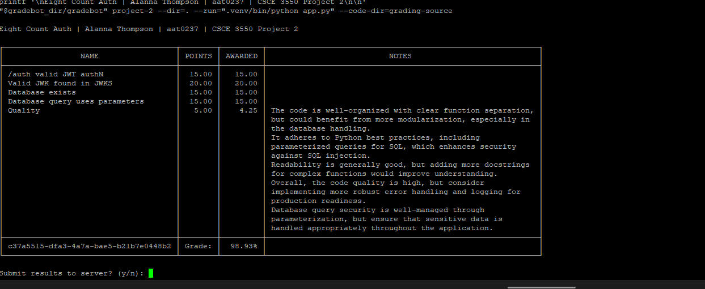
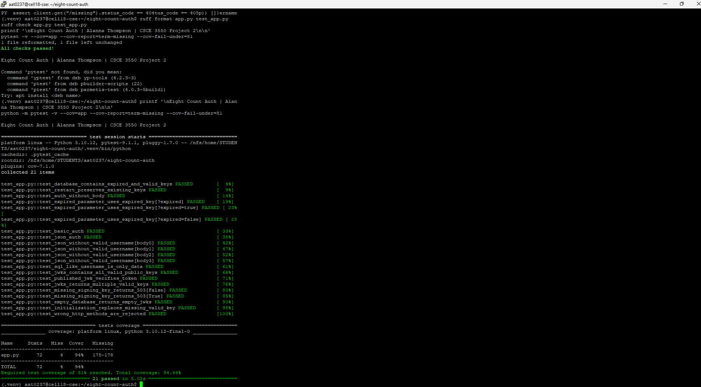

# Eight Count Auth

**Alanna Thompson | aat0237 | CSCE 3550 — Project 2**

Eight Count Auth is a Python JWKS server backed by SQLite. Its name
comes from the eight counts used in dance.

The server generates RSA keys, stores them in a database, issues signed
JSON Web Tokens (JWTs), and publishes public keys for verification.

## Requirements

- Python 3.10 or newer
- Dependencies listed in requirements.txt
- Port 8080 available

## Setup and Run

Run these commands from the project directory:

```bash
python3 -m venv .venv
source .venv/bin/activate
python -m pip install -r requirements.txt
python app.py
```

If the system does not support venv because ensurepip is missing:

```bash
python3 -m pip install --user virtualenv
python3 -m virtualenv .venv
source .venv/bin/activate
python -m pip install -r requirements.txt
python app.py
```

The server listens at http://127.0.0.1:8080.

## Endpoints

| Method | Endpoint | Behavior |
| --- | --- | --- |
| POST | /auth | Returns an unexpired JWT signed with a valid database key |
| POST | /auth?expired | Returns an expired JWT signed with an expired database key |
| GET | /.well-known/jwks.json | Returns public JWKs for all unexpired database keys |

Authentication is mocked for this assignment. The auth endpoint accepts
HTTP Basic authentication, a JSON username/password payload, or no body.
Passwords are not verified.

The presence of the expired query parameter selects an expired key,
regardless of the parameter's value.

## Database and Key Handling

The server creates totally_not_my_privateKeys.db in the current working
directory using this schema:

```sql
CREATE TABLE IF NOT EXISTS keys (
    kid INTEGER PRIMARY KEY AUTOINCREMENT,
    key BLOB NOT NULL,
    exp INTEGER NOT NULL
);
```

Private keys are stored as PKCS1 PEM bytes. Expiration times use Unix
timestamps. SQL values are passed through bound parameters rather than
inserted into query strings.

At startup, the server ensures there is an expired key and a key valid
for at least another hour. Existing records are preserved on restart.
Each auth request reads its signing key from SQLite.

JWTs use RS256 and include the database key ID as a string in the kid
header. The JWKS endpoint publishes only public RSA components, never
private key material.

If no matching signing key is available, /auth returns HTTP 503.
Restarting the server replenishes the required keys.

## Tests and Coverage

```bash
python -m pytest -v --cov=app --cov-report=term-missing --cov-fail-under=81
```

Verified results: **21 tests passed; 94.44% statement coverage.**

Tests cover signature verification, expired tokens, Basic and JSON
requests, database persistence, public key output, and missing keys.
Tests use temporary databases separate from the server database.

## Formatting and Linting

```bash
ruff format --check app.py test_app.py
ruff check app.py test_app.py
```

## Gradebot

Using the Linux tester from the course release page, run from the
project directory with port 8080 free:

```bash
mkdir -p grading-source
cp app.py grading-source/app.py
/path/to/gradebot project-2 --dir=. --run=".venv/bin/python app.py" --code-dir=grading-source
```

Replace /path/to/gradebot with the executable's actual location.
Gradebot launches the server. The separate source folder prevents it
from scanning the virtual environment.

Verified Gradebot result: **98.93%**, including full points for JWT
authentication, JWKS verification, database existence, and parameterized
queries. This is the tester result, not the final course grade.

## Screenshots





## Project Files

- app.py: server, key generation, and database operations
- test_app.py: automated test suite
- requirements.txt: installed dependency versions
- screenshots/: identified Gradebot and test results
- .gitignore: excludes generated files and private key databases

## Educational Scope

This project uses mock authentication and Flask's development server.
Private keys are stored unencrypted in SQLite for the assignment.
The generated database is excluded from version control and is created
automatically when the server starts.
